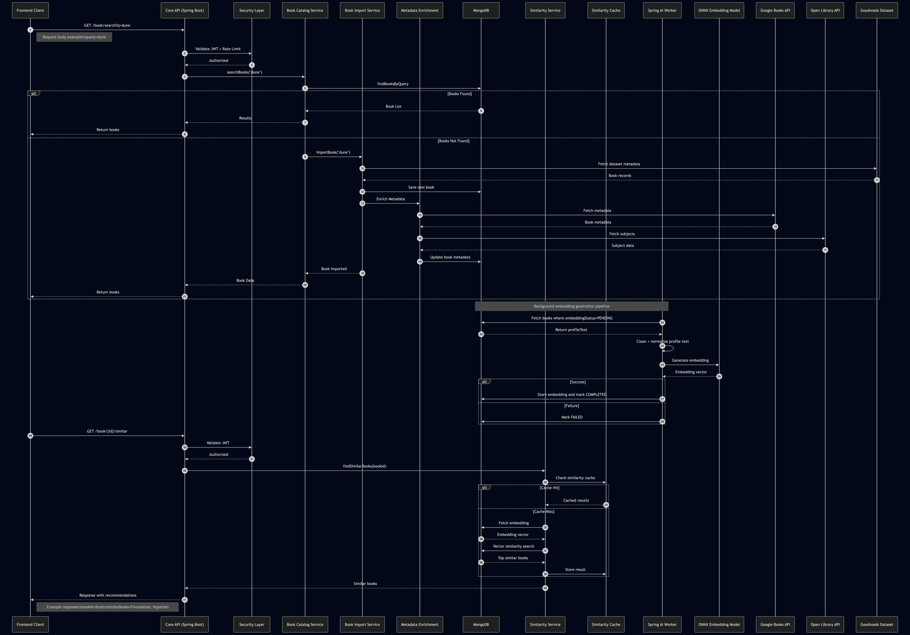

## MVP 1: User Authentication and Basic Book Posting

                                    

#### User Authentication

  - [x] User registration with email.
  - [ ] Email verification with OTP.
  - [x] User login/logout functionality.

#### Book Posting:
- [x] Allow users to create posts about books they've read.
- [x] Basic form for entering book details: title, author, review text.
- [x] Rich text editor for composing reviews (optional for MVP 1).

## MVP 2: Post Suggestion and Book Similarity

### Post Suggestion:
- [x] Allow users to view and select suggested posts when visiting Posts.
- [x] Allow users to add images, quotes, and headings to reviews.

### Book Schema and Storage
- [ ] Extend `Book` MongoDB schema to support similarity system fields.
- [ ] Add fields for `profileText`, `embedding`, `embeddingStatus`, `embeddingModel`, and `embeddingVersion`.
- [ ] Implement repository methods to query books by `bookId`, `ISBN`, or `slug`.
- [ ] Add indexes for `bookId` and embedding-related queries.

### Book Catalog Services
- [ ] Implement `BookCatalogService` for retrieving and managing books.
- [ ] Implement `BookProfileBuilder` to generate profile text from book metadata.
- [ ] Store generated `profileText` inside MongoDB.

### Core API Endpoints
- [ ] Implement `GET /book/{id}` endpoint to fetch book details.
- [ ] Implement `GET /book/search` endpoint for searching books.
- [ ] Integrate with existing authentication and rate limiting.

---

## MVP 3: Dataset Import and Metadata Enrichment

### Dataset Import
- [ ] Implement `BookImportService` to import books from the Kaggle Goodreads dataset.
- [ ] Normalize dataset fields into internal `Book` schema.
- [ ] Deduplicate books using ISBN or canonical book identifiers.

### Metadata Enrichment
- [ ] Implement `GoogleBooksClient` to fetch metadata.
- [ ] Implement `OpenLibraryClient` for additional metadata.
- [ ] Enrich books with description, categories, subjects, and cover URLs.
- [ ] Store enriched metadata in MongoDB.

### Admin APIs
- [ ] Implement `POST /admin/books/import` to trigger dataset ingestion.
- [ ] Implement `POST /admin/books/enrich` to run metadata enrichment jobs.

---

## MVP 4: Book Profile Generation

### Profile Builder
- [ ] Implement `BookProfileService` to generate embedding-ready text profiles.
- [ ] Combine metadata fields:
    - title
    - author
    - categories
    - description
    - review insights
- [ ] Save generated profile text in `profileText` field.

### Profile Management
- [ ] Track profile generation version.
- [ ] Mark books as `embeddingStatus = PENDING` after profile creation.
- [ ] Implement async job to regenerate profiles if metadata changes.

---

## MVP 5: Embedding Worker (Spring AI Service)

### Secondary Spring AI API
- [ ] Create separate `embedding-worker` Spring Boot project.
- [ ] Integrate Spring AI ONNX embedding model.
- [ ] Load embedding model (`all-MiniLM-L6-v2` or equivalent).

### Embedding Pipeline
- [ ] Fetch books where `embeddingStatus = PENDING`.
- [ ] Clean and normalize profile text.
- [ ] Generate embedding vectors using ONNX model.
- [ ] Store embeddings back in MongoDB.

### Failure Handling
- [ ] Mark embedding failures with `embeddingStatus = FAILED`.
- [ ] Implement retry logic with retry counters.
- [ ] Implement dead-letter handling for repeated failures.

---

## MVP 6: Similarity Engine

### Vector Similarity Service
- [ ] Implement `BookSimilarityService`.
- [ ] Retrieve target book embedding.
- [ ] Compute cosine similarity between vectors.
- [ ] Retrieve top N similar books.

### Similarity API
- [ ] Implement endpoint `GET /book/{id}/similar`.
- [ ] Return top similar books with similarity scores.
- [ ] Include book metadata in response (title, author, cover).

#### Example Response

```json
{
  "bookId": "dune",
  "similarBooks": [
    {
      "bookId": "foundation",
      "title": "Foundation",
      "similarityScore": 0.93
    },
    {
      "bookId": "hyperion",
      "title": "Hyperion",
      "similarityScore": 0.89
    }
  ]
}
```
---

## MVP 7: Similarity Cache and Performance

### Similarity Cache
- [ ] Create book_similarity_cache collection.
- [ ] Cache similarity results for frequently accessed books.
- [ ] Implement cache invalidation logic when embeddings update.
- 
### Optimization
- [ ] Implement background job to precompute similarity for popular books.
- [ ] Limit vector comparisons using top-K filtering.
- [ ] Add MongoDB indexes for similarity queries.

---

## MVP 8: Review Insight Extraction (Optional)

### Review Processing

- [ ] Extract review keywords from dataset.
- [ ] Identify phrases indicating book tone and pacing.
- [ ] Store review insights inside book documents.

### Profile Enhancement
- [ ] Incorporate review insights into profile text generation.
- [ ] Regenerate embeddings when review insights change.

---

## MVP 9: System Monitoring and Maintenance

### Monitoring
- [ ] Log embedding generation failures.
- [ ] Track embedding generation time and queue size.
- [ ] Monitor similarity query latency.

### Admin Tools
- [ ] Implement POST /admin/books/reindex to regenerate embeddings.
- [ ] Implement GET /admin/books/embedding-status dashboard endpoint.

---

## MVP 10: Frontend Support (Future)

### UI Integration
- [ ] Display similar books in book detail pages.
- [ ] Implement visual similarity exploration UI.
- [ ] Prepare backend for graph-style book similarity visualization.

### Long-Term Improvements
- [ ] Implement collaborative filtering using user posts.
- [ ] Build a visual "Book Galaxy" similarity map.
- [ ] Add genre-based clustering of books.
- [ ] Integrate recommendation engine using reading behavior.
- [ ] Add trending book detection based on activity signals.


---
---
---
---


MVP 3: Enhanced Book Details and Book Lists

Enhanced Book Details:
- [ ] Expand book details in posts: add genre, publication date, rating.

Book Lists:
- [ ] Enable users to create "To Be Read" and "Already Read" lists.
- [ ] Allow users to add and remove books from their lists.


 4: External Links and Price Comparison

External Links:
- [ ] Allow users to add links to purchase the book from external sources.
- [ ] Display links in book details.

Price Comparison:
- [ ] Integrate a web scraper to find and display the top 3 cheapest prices for the book from online retailers.


 5: Basic Recommendation System

Basic Recommendations:
- [ ] Provide basic recommendations based on user's favorite categories.
- [ ] Implement filters and sorting options for search and recommendation pages.

 6: Trending Books and Genre Communities

Trending Books:
- [ ] Display a list of trending books based on recent customer reviews and reads.
- [ ] Implement a simple algorithm considering factors like recent activity, ratings, and reviews.


Genre Communities (Optional for MVP):
- [ ] Create basic genre-based discussion communities.
- [ ] Allow users to interact and discuss books within specific genres.

